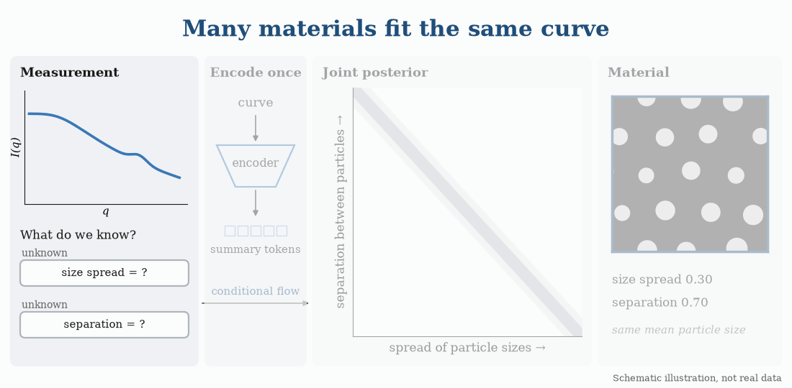

# Amortized conditional inference for SAXS

A SAXS curve does not uniquely determine the material that produced it. Different
parameter values can explain the same curve, and which of them remain plausible depends
on what else is known about the sample.

This repository contains the code and trained models for the paper *Amortized conditional
inference under changing parameter information in small-angle X-ray scattering*. A
flow-matching model is trained once on simulated curves. For a given curve, each
parameter can then be left unknown, fixed to a value, or supplied with an uncertainty,
and the model returns the joint posterior of the unknown parameters without retraining.



The animation is a schematic example. The SAXS simulator, training data and measurements
are not included, and the trained models run without them.

## Installation

```bash
git clone https://github.com/mariabankestad/aisaxs-sbi.git
cd aisaxs-sbi
pip install -r requirements.txt
```

Tested with Python 3.14 and PyTorch 2.14.

## Usage

```python
import numpy as np
from saxs.infer import Posterior

# Example curve: q in 1/Å, I as linear intensity
q = np.geomspace(0.008, 0.4, 1500)
I = 1e3 * q**-2.5 * (1 + 3 * np.exp(-(((q - 0.18) / 0.04) ** 2)))

post = Posterior("checkpoints/saxs_seed0.pt")
x, sigma = post.observe(q, I, window=(0.05, 0.30), sigma=0.003)

# All parameters unknown
samples = post.sample(x, n_samples=2000)

# One parameter fixed
samples = post.sample(x, exact={"SLD_tubes": 0.8}, n_samples=2000)

# One parameter known with an uncertainty
samples = post.sample(x, soft={"radius_nm": (1.5, 0.1, "phys")}, n_samples=2000)
```

`samples` has one row per posterior sample and one column per parameter:

| Parameter | Description |
|---|---|
| `radius_nm` | fibril radius (nm) |
| `kappa_sc` | inverse correlation length of the disordered matrix |
| `volfrac_grf` | volume fraction of the disordered matrix |
| `no_rods_per_unit` | fibril count factor |
| `min_space_nm` | minimum separation between fibrils (nm) |
| `size_cv` | spread of the fibril sizes |
| `SLD_tubes` | density of the fibril phase |
| `SLD_grf_1` | density of the disordered matrix |
| `SLD_grf_2` | density of the interstitial phase |

- `window`: the lower edge can be 0.01 to 0.10 1/Å, and the upper edge up to 0.30 1/Å.
- `sigma`: noise level in log10 intensity. It is estimated from the curve if omitted,
  which requires a measured curve.
- `delta`: shift in log10 intensity that aligns a curve with the simulations. Use the
  same value for all curves in a series.

The three checkpoints are the same model trained with different seeds.

## Training

Gaussian benchmark with known posteriors, which needs no SAXS data:

```bash
python -m benchmarks.train --task correlated_gaussian --conditioning cross_two \
    --n-obs-tokens 4 --soft --d-model 40 --n-layers 6 --n-heads 8 \
    --n-train 20000 --n-val 5000 --max-epochs 200 --patience 50 \
    --seed 0 --save gaussian.pt

python -m benchmarks.eval_soft --checkpoint gaussian.pt
```

SAXS model, using simulated banks in the format described in `saxs/bank.py` and a noise
template CSV with the columns `q` and `sd`:

```bash
python -m saxs.train --bank TRAIN_BANK --val-bank VAL_BANK --template NOISE.csv \
    --cosine --max-epochs 1400 --patience 5000 --no-ot-pairing \
    --seed 0 --save model.pt
```

`python -m saxs.evaluate` measures coverage and accuracy on a held-out bank.

## Repository structure

```
cfm/           flow-matching model and observation pipeline
saxs/          SAXS training, inference and evaluation
benchmarks/    Gaussian task and metrics
checkpoints/   trained SAXS models
```
